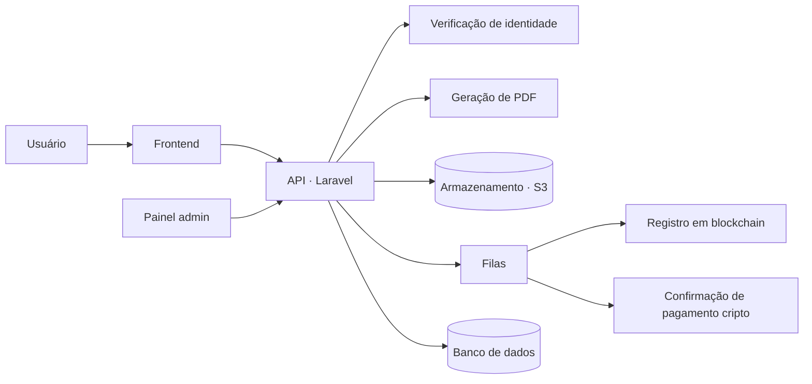

# Testamento digital com registro em blockchain

> Plataforma para criar, assinar e registrar testamentos online, com verificação de identidade, testemunhas e registro imutável em blockchain.

> **Repositório vitrine.** O código-fonte é privado. Aqui estão a arquitetura e as decisões técnicas. Demonstração técnica disponível sob solicitação.

## O problema

Fazer um testamento costuma ser caro, demorado e cheio de papel. A plataforma guia a pessoa pelo processo online e garante a autenticidade do documento: identidade verificada, assinaturas, testemunhas e prova de existência registrada em blockchain.

## O que o sistema faz

- **Montagem guiada do testamento**: bens, herdeiros, beneficiários especiais, guardiões de filhos menores, pets e declarações familiares
- **Testamenteiros e testemunhas** convidados para o processo
- **Verificação de identidade (KYC)**
- **Assinatura digital** e **geração do PDF** final
- **Registro on-chain** do testamento, com confirmação da transação acompanhada em segundo plano
- **Pagamentos e assinaturas de planos**, inclusive em cripto
- **Autenticação em dois fatores (2FA)**
- **Painel administrativo** com log de auditoria, suporte e pedidos de dados do titular (LGPD/GDPR)

## Arquitetura

- A API é consumida por um frontend e por um painel administrativo separados.
- O **registro em blockchain** e a **confirmação de pagamentos** rodam em filas, com consulta periódica até a confirmação.
- Toda ação administrativa fica registrada em **log de auditoria**.

## Destaques técnicos

- Modelagem de domínio jurídico extensa (bens, herdeiros, guardiões, testemunhas, eventos do testamento)
- Segurança: 2FA, controle de permissões por papel e auditoria completa
- Documentação de API gerada automaticamente (OpenAPI via Scramble)
- Testes automatizados em PHPUnit

## Stack

| Camada | Tecnologias |
|---|---|
| Backend | PHP, Laravel, Sanctum, Spatie Permission, Spatie Activitylog |
| Segurança | Google 2FA, KYC, controle de acesso por papel |
| Documentos | DomPDF, AWS S3 |
| Blockchain | Registro de prova de existência on-chain |

## Status

Em desenvolvimento.

## Autor

**Felipe Lopes** · Full-stack e fundador da [FML Tech](https://fmlsoftware.com.br)
Arquitetura e backend.
